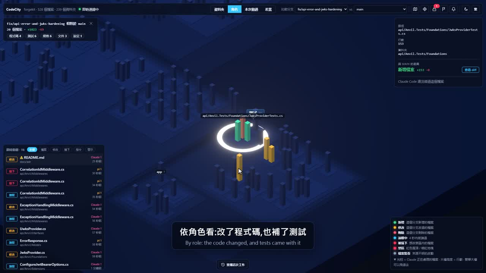

# game-view-ideas

[繁體中文](README.zh-TW.md)

Ideas for presenting structured data as game-like, isometric or 3D scenes — and one of those ideas
built into a working tool.

## Contents

- `codecity/` — draws a repo as a 3D city to supervise AI coding agents live: what they read and
  write, locked zones that block writes, and branch comparison by git diff. Start with
  `codecity/README.md`.

Demo video with voice-over (about 4 minutes): click the image, or see the
[release](https://github.com/Zuexx/game-view-ideas/releases/tag/codecity-demo).

## Conventions

- Video files (`*.mp4`, `*.webm`, `*.mkv`) are git-ignored; the demo video is attached to a release.
- CodeCity's `node_modules/`, `web/dist/` and live data in `data/` (event log, locked zones) are not
  versioned either.
- Docs are written in English first, with a Traditional Chinese version next to them (`*.zh-TW.md`).

## License

MIT — see `LICENSE`.
