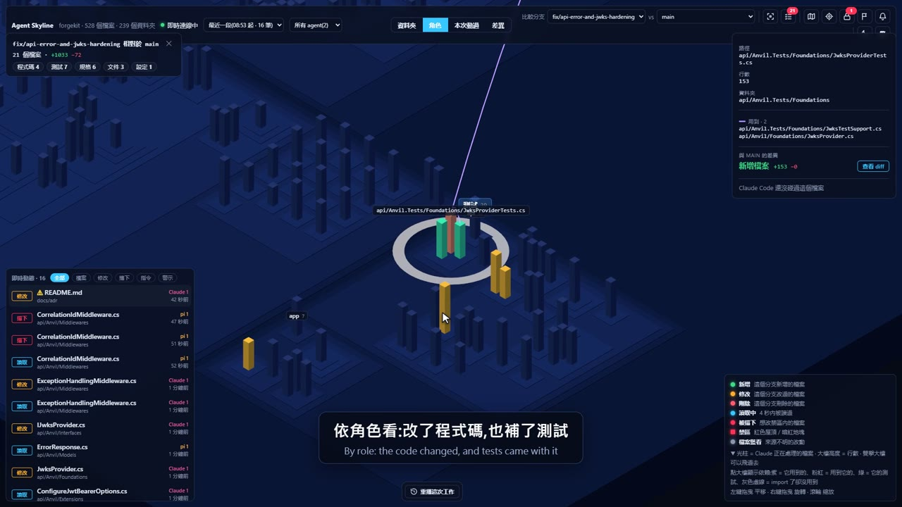

# Agent Skyline

[English](README.md)

**看著 AI coding agent 工作,在它寫進不該碰的地方之前擋下來。**

Agent Skyline 把 git repo 畫成一座 3D 城市:資料夾是街區、檔案是大樓、大樓高度是行數。Claude Code(或 pi)讀寫檔案時,對應的大樓會即時亮起來。

[](https://github.com/Zuexx/agent-skyline/releases/download/demo/agent-skyline-demo.mp4)

▶ 演示影片(約 4 分鐘):點上面的圖片,或到 [release 頁面](https://github.com/Zuexx/agent-skyline/releases/tag/demo)下載。

## 能做什麼

- **即時看見**:agent 讀了哪些檔案(藍色)、改了哪些(琥珀色),當下就看得到。
- **鎖住資料夾**:寫進禁區的動作會**在發生之前就被擋下**,不論是 Edit/Write,還是 `echo … > file` 這類 shell 指令。
- **Review 分支**:和 `main` 比較,城市依 git diff 上色;review 清單把風險最高的改動排在前面(沒有測試、很多檔案依賴、改動很大)。
- **派工作**:拖曳框選幾棟大樓,這些檔案就變成交給 agent 的任務範圍。

只在你的電腦上執行(伺服器只綁 127.0.0.1),支援 **Claude Code** 和 **pi**。其他人或其他工具改的檔案,也會透過檔案監看顯示出來。

## 快速開始

需要 Node 22 以上和 git。任何資料夾都可以;是 git repo 的話,另外還有分支比較和 diff。

```bash
git clone https://github.com/Zuexx/agent-skyline.git
cd agent-skyline
npm link        # 只要一次:安裝 `skyline` 指令
```

之後在任何 repo 或資料夾裡:

```bash
cd D:/path/to/your/repo
skyline
```

這樣就好了。瀏覽器會打開城市,Claude Code 也接上這個 repo 了:在那裡**新開**一個 Claude Code 工作階段,就能看到它在做什麼。之後這個 repo 的每個 Claude Code 工作階段都會自動帶起城市。第一次執行會順便建置畫面,大約要一分鐘。

| 指令 | 作用 |
|---|---|
| `skyline` | 接上這個 repo 並打開城市。重複執行也沒關係。 |
| `skyline off` | 解除這個 repo 的連接並關掉城市 |
| `skyline status` | 列出正在跑的城市 |

`skyline` 把 hook 寫進 `<repo>/.claude/settings.local.json`(檔案裡原本的其他設定會保留),並確保 git 會忽略這個檔案。

手邊沒有 agent?`node cli/simulate.mjs` 可以播放一段模擬的工作,用法見完整說明。

## 延伸閱讀

| 文件 | 內容 |
|---|---|
| [`docs/guide.zh-TW.md`](docs/guide.zh-TW.md) | 完整說明:pi、開工作階段時自動啟動、禁區、畫面上每個功能、測試 |
| [`docs/NOTES.zh-TW.md`](docs/NOTES.zh-TW.md) | 構想,以及為什麼做成這樣 |
| [`docs/PROGRESS.zh-TW.md`](docs/PROGRESS.zh-TW.md) | 開發過程:每個決定,和一次事故 |

原名 CodeCity,因為已經有好幾個專案用了這個名字,所以改名。

## 授權

MIT,見 [`LICENSE`](LICENSE)。
